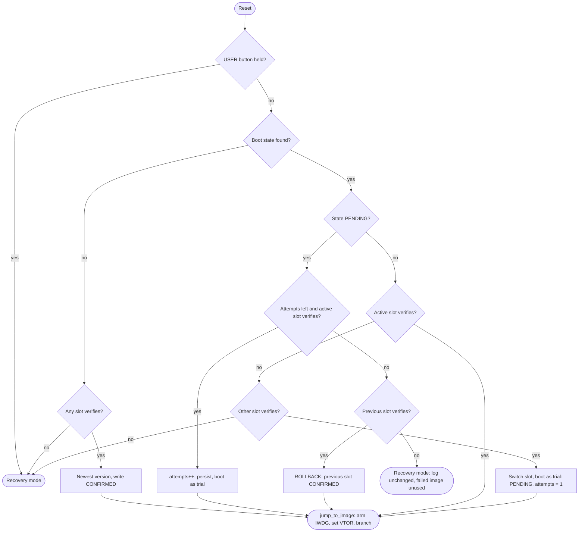

# Secure Bootloader: Code Walkthrough

Oct 12, 2026

## Overview

The repo is a register-level A/B secure bootloader for the NUCLEO-F429ZI (STM32F429ZI, 2 MB dual-bank flash, 192 KB SRAM). It verifies an ECDSA P-256 signature on every boot, trial-boots new images with automatic rollback, and enforces an anti-rollback counter. No HAL or CMSIS is used; every peripheral is driven through the register definitions in [common/stm32f429.h](https://github.com/noaros/Secure-Bootloader/blob/82ad09a952a1662acb68a16913aed8c970f01d73/common/stm32f429.h).

| Path | Role |
| --- | --- |
| [bootloader/main.c](https://github.com/noaros/Secure-Bootloader/blob/82ad09a952a1662acb68a16913aed8c970f01d73/bootloader/main.c) | Bootloader entry: reset handling, boot decision, recovery mode, hand-over to the app |
| [app/main.c](https://github.com/noaros/Secure-Bootloader/blob/82ad09a952a1662acb68a16913aed8c970f01d73/app/main.c) | Demo application: slot-aware, confirms itself, receives updates into the other slot |
| [common/image.c](https://github.com/noaros/Secure-Bootloader/blob/82ad09a952a1662acb68a16913aed8c970f01d73/common/image.c) | Image header parsing, hash and signature verification |
| [common/bootstate.c](https://github.com/noaros/Secure-Bootloader/blob/82ad09a952a1662acb68a16913aed8c970f01d73/common/bootstate.c) | Append-only boot-state log and the `boot_decide` policy |
| [common/update.c](https://github.com/noaros/Secure-Bootloader/blob/82ad09a952a1662acb68a16913aed8c970f01d73/common/update.c) | UART update protocol, shared by the app and recovery mode |
| [common/flash\_stm32.c](https://github.com/noaros/Secure-Bootloader/blob/82ad09a952a1662acb68a16913aed8c970f01d73/common/flash_stm32.c) | Flash erase/program driver; [flash\_geom.c](https://github.com/noaros/Secure-Bootloader/blob/82ad09a952a1662acb68a16913aed8c970f01d73/common/flash_geom.c) maps addresses to sectors |
| [common/board.c](https://github.com/noaros/Secure-Bootloader/blob/82ad09a952a1662acb68a16913aed8c970f01d73/common/board.c) | Clocks, LEDs, button, UART, watchdog, option-byte status |
| [common/startup.c](https://github.com/noaros/Secure-Bootloader/blob/82ad09a952a1662acb68a16913aed8c970f01d73/common/startup.c) | Vector table and `Reset_Handler` used by both images |
| [common/sha256.c](https://github.com/noaros/Secure-Bootloader/blob/82ad09a952a1662acb68a16913aed8c970f01d73/common/sha256.c), [crc32.c](https://github.com/noaros/Secure-Bootloader/blob/82ad09a952a1662acb68a16913aed8c970f01d73/common/crc32.c) | Hash and checksum primitives |
| [third\_party/micro-ecc](https://github.com/noaros/Secure-Bootloader/tree/82ad09a952a1662acb68a16913aed8c970f01d73/third_party/micro-ecc) | Vendored ECDSA verification (BSD-2-Clause) |
| [linker/](https://github.com/noaros/Secure-Bootloader/tree/82ad09a952a1662acb68a16913aed8c970f01d73/linker) | Bootloader and per-slot app linker scripts |
| [tools/imgtool.py](https://github.com/noaros/Secure-Bootloader/blob/82ad09a952a1662acb68a16913aed8c970f01d73/tools/imgtool.py), [tools/update.py](https://github.com/noaros/Secure-Bootloader/blob/82ad09a952a1662acb68a16913aed8c970f01d73/tools/update.py) | Host-side signing and UART uploader |
| [test/](https://github.com/noaros/Secure-Bootloader/tree/82ad09a952a1662acb68a16913aed8c970f01d73/test) | Host unit tests against a simulated NOR flash |

## Memory layout

Flash is split into a 32 KB bootloader, two 16 KB boot-state log sectors, and two 384 KB image slots in different banks. The constants live in [common/layout.h:21-40](https://github.com/noaros/Secure-Bootloader/blob/82ad09a952a1662acb68a16913aed8c970f01d73/common/layout.h#L21-L40), and the diagram in its header comment is at [layout.h:1-17](https://github.com/noaros/Secure-Bootloader/blob/82ad09a952a1662acb68a16913aed8c970f01d73/common/layout.h#L1-L17).

| Address | Sectors | Size | Contents |
| --- | --- | --- | --- |
| `0x08000000` | 0-1 (bank 1) | 32 KB | Bootloader (`BOOTLOADER_ADDR`, `BOOTLOADER_SIZE`) |
| `0x08008000` | 2 | 16 KB | Boot-state log, copy 0 (`BOOTSTATE_ADDR0`) |
| `0x0800C000` | 3 | 16 KB | Boot-state log, copy 1 (`BOOTSTATE_ADDR1`) |
| `0x08010000` | 4 | 64 KB | Unused |
| `0x08020000` | 5-7 | 384 KB | Slot A (`SLOT_A_ADDR`) |
| `0x08080000` | 8-11 | 512 KB | Unused |
| `0x08100000` | 12-16 (bank 2) | 384 KB | Unused |
| `0x08120000` | 17-19 | 384 KB | Slot B (`SLOT_B_ADDR`) |
| `0x08180000` | 20-23 | 512 KB | Unused |
| `0x20000000` | SRAM | 192 KB | Shared stack, `.data`, `.bss` for whichever image runs |

Putting slot A in bank 1 and slot B in bank 2 lets the running app erase and program the other slot with read-while-write, so the CPU does not stall fetching its own code. The slot index maps to an address in [`slot_addr()`](https://github.com/noaros/Secure-Bootloader/blob/82ad09a952a1662acb68a16913aed8c970f01d73/common/layout.h#L44-L47) and to a letter in [`slot_name()`](https://github.com/noaros/Secure-Bootloader/blob/82ad09a952a1662acb68a16913aed8c970f01d73/common/layout.h#L49-L52).

### Inside a slot

Each slot begins with a 512-byte block holding the 128-byte [`image_header_t`](https://github.com/noaros/Secure-Bootloader/blob/82ad09a952a1662acb68a16913aed8c970f01d73/common/image.h#L22-L34), padded with `0xFF`. The app's vector table starts at slot base + `0x200`, which satisfies the Cortex-M4 VTOR alignment rule for a 16-entry table.

| Offset | Field | Signed? |
| --- | --- | --- |
| `0x00` | `magic` = `"SBI1"` (`0x31494253`) | yes |
| `0x04` | `hdr_version` (1), `hdr_size` (`0x200`) | yes |
| `0x08` | `load_addr`: the slot base this build was linked for | yes |
| `0x0C` | `img_size`: payload bytes after the header | yes |
| `0x10` | `version`: `major<<24 \| minor<<16 \| patch` | yes |
| `0x14` | `security_counter`: anti-rollback value | yes |
| `0x18` | `flags`, `reserved` | yes |
| `0x20` | `payload_sha256`: SHA-256 of the payload | yes |
| `0x40` | `signature`: ECDSA P-256 `r\|\|s` over SHA-256 of bytes `0x00-0x3F` | no (it is the signature) |

Two static asserts pin this layout: total size 128 and signature offset 64 ([image.h:36-37](https://github.com/noaros/Secure-Bootloader/blob/82ad09a952a1662acb68a16913aed8c970f01d73/common/image.h#L36-L37)). Because the payload hash sits inside the signed 64 bytes, one signature covers the header fields and the code.

### Linker scripts

Each image has a tiny `.ld` that defines `MEMORY` and then includes the shared [linker/sections.ld](https://github.com/noaros/Secure-Bootloader/blob/82ad09a952a1662acb68a16913aed8c970f01d73/linker/sections.ld).

- [bootloader.ld](https://github.com/noaros/Secure-Bootloader/blob/82ad09a952a1662acb68a16913aed8c970f01d73/linker/bootloader.ld#L1-L6) places code at `0x08000000` with a 32 KB limit, so an oversize bootloader fails to link.
- [app\_slot\_a.ld](https://github.com/noaros/Secure-Bootloader/blob/82ad09a952a1662acb68a16913aed8c970f01d73/linker/app_slot_a.ld#L2-L6) and [app\_slot\_b.ld](https://github.com/noaros/Secure-Bootloader/blob/82ad09a952a1662acb68a16913aed8c970f01d73/linker/app_slot_b.ld#L2-L6) start FLASH at slot base + `0x200`. The app is position-dependent, so it is linked twice and each build is signed with its own `load_addr`.
- [sections.ld](https://github.com/noaros/Secure-Bootloader/blob/82ad09a952a1662acb68a16913aed8c970f01d73/linker/sections.ld#L4-L48) puts `.isr_vector` first, sets `_estack` to the top of RAM ([line 4](https://github.com/noaros/Secure-Bootloader/blob/82ad09a952a1662acb68a16913aed8c970f01d73/linker/sections.ld#L4)), loads `.data` from flash into RAM, and asserts at least 4 KB of stack headroom ([line 46](https://github.com/noaros/Secure-Bootloader/blob/82ad09a952a1662acb68a16913aed8c970f01d73/linker/sections.ld#L46)).

Both images use the same RAM range. That is safe because only one runs at a time and the bootloader hands over with a fresh stack pointer (see *Jumping to the application*).

## Boot flow

Every reset runs the same path: start-up code, board init, a recovery-button check, then `boot_decide()` picks a verified slot or falls into recovery. The steps below follow the code in execution order.

### 1. Reset and C runtime start-up

The Cortex-M4 fetches the initial stack pointer and reset vector from `0x08000000`. Both come from the 16-entry `vector_table` in [common/startup.c:19-34](https://github.com/noaros/Secure-Bootloader/blob/82ad09a952a1662acb68a16913aed8c970f01d73/common/startup.c#L19-L34), placed first by `KEEP(*(.isr_vector))` in [sections.ld:8-11](https://github.com/noaros/Secure-Bootloader/blob/82ad09a952a1662acb68a16913aed8c970f01d73/linker/sections.ld#L8-L11). Only core exceptions are listed; no peripheral IRQs are used.

[`Reset_Handler`](https://github.com/noaros/Secure-Bootloader/blob/82ad09a952a1662acb68a16913aed8c970f01d73/common/startup.c#L36-L46) copies `.data` from flash to RAM, zeroes `.bss`, and calls `main()`. Every unhandled exception lands in [`Default_Handler`](https://github.com/noaros/Secure-Bootloader/blob/82ad09a952a1662acb68a16913aed8c970f01d73/common/startup.c#L53-L57), an infinite loop. In an app that loop is broken by the watchdog; in the bootloader the watchdog is not yet armed, so a fault there hangs until a manual reset.

### 2. Board init and banner

[`main()`](https://github.com/noaros/Secure-Bootloader/blob/main/bootloader/main.c#L109-L134) first calls [`board_init()`](https://github.com/noaros/Secure-Bootloader/blob/82ad09a952a1662acb68a16913aed8c970f01d73/common/board.c#L32-L56). That function:

- enables GPIOB/C/D and USART3 clocks ([board.c:34-36](https://github.com/noaros/Secure-Bootloader/blob/82ad09a952a1662acb68a16913aed8c970f01d73/common/board.c#L34-L36));
- sets PB0/PB7/PB14 as LED outputs (green, blue, red) and PC13 as the USER button input ([board.c:38-42](https://github.com/noaros/Secure-Bootloader/blob/82ad09a952a1662acb68a16913aed8c970f01d73/common/board.c#L38-L42));
- routes USART3 to PD8/PD9, the ST-LINK virtual COM port, at 115200 baud from the 16 MHz HSI ([board.c:44-48](https://github.com/noaros/Secure-Bootloader/blob/82ad09a952a1662acb68a16913aed8c970f01d73/common/board.c#L44-L48)); the clock is never raised ([board.h:7](https://github.com/noaros/Secure-Bootloader/blob/82ad09a952a1662acb68a16913aed8c970f01d73/common/board.h#L7));
- starts a 1 ms SysTick used for timeouts and delays ([board.c:50-52](https://github.com/noaros/Secure-Bootloader/blob/82ad09a952a1662acb68a16913aed8c970f01d73/common/board.c#L50-L52));
- freezes the IWDG while a debugger halts the core ([board.c:55](https://github.com/noaros/Secure-Bootloader/blob/82ad09a952a1662acb68a16913aed8c970f01d73/common/board.c#L55)).

Next, [`reset_cause(0)`](https://github.com/noaros/Secure-Bootloader/blob/82ad09a952a1662acb68a16913aed8c970f01d73/common/board.c#L161-L186) reads `RCC_CSR` without clearing it ([main.c:112](https://github.com/noaros/Secure-Bootloader/blob/main/bootloader/main.c#L112)), so the app can still see that a watchdog reset occurred. [`print_protection()`](https://github.com/noaros/Secure-Bootloader/blob/main/bootloader/main.c#L23-L36) decodes `FLASH_OPTCR`: RDP byte `0xAA` is level 0, `0xCC` is level 2, anything else level 1; write protection is ON when nWRP bits 0-1 are cleared and PCROP mode is off.

### 3. Recovery button

If USER is held, the code waits 50 ms and samples again before entering [`recovery()`](https://github.com/noaros/Secure-Bootloader/blob/main/bootloader/main.c#L71-L107) ([main.c:120-124](https://github.com/noaros/Secure-Bootloader/blob/main/bootloader/main.c#L120-L124)). The second sample filters contact bounce. Recovery is described under *Firmware update protocol*.

### 4. Boot decision

With the red LED lit as a busy indicator, `main()` calls [`boot_decide()`](https://github.com/noaros/Secure-Bootloader/blob/main/common/bootstate.c#L113-L205) ([main.c:126-129](https://github.com/noaros/Secure-Bootloader/blob/main/bootloader/main.c#L126-L129)). The policy lives in `common/` rather than `bootloader/` so the host tests run the exact code the device runs. It fills a [`boot_decision_t`](https://github.com/noaros/Secure-Bootloader/blob/main/common/bootstate.h#L44-L49): slot to boot (or -1), a trial flag, the persisted state, and the verified header.

#### The boot-state log

The decision depends on a persistent [`boot_state_t`](https://github.com/noaros/Secure-Bootloader/blob/main/common/bootstate.h#L25-L35) record: 32 bytes holding magic `"BSTA"`, a sequence number, `active_slot`, `state` (`CONFIRMED` = `0xC3` or `PENDING` = `0x5A`), an `attempts` counter, `min_security_counter`, and a CRC-32 over the first 28 bytes.

Records are appended to a log spread across sectors 2 and 3, 512 records per sector.

- **Reading.** [`find_latest()`](https://github.com/noaros/Secure-Bootloader/blob/main/common/bootstate.c#L21-L39) scans both sectors, keeps records that pass [`record_valid()`](https://github.com/noaros/Secure-Bootloader/blob/main/common/bootstate.c#L12-L18), and picks the highest `seq` using a wrap-safe signed difference ([line 30](https://github.com/noaros/Secure-Bootloader/blob/main/common/bootstate.c#L30)).
- **Writing.** [`bs_store()`](https://github.com/noaros/Secure-Bootloader/blob/main/common/bootstate.c#L47-L86) takes `seq + 1`, then looks for the first blank 32-byte slot after the newest record, skipping torn writes. When the sector is full it erases the other sector and continues there ([lines 65-73](https://github.com/noaros/Secure-Bootloader/blob/main/common/bootstate.c#L65-L73)); the newest record survives because it lives in the sector not being erased.
- **Power-loss safety.** The body is programmed first and the CRC word last ([lines 81-85](https://github.com/noaros/Secure-Bootloader/blob/main/common/bootstate.c#L81-L85)). A power cut mid-write leaves a record with a bad or blank CRC, which reads as invalid, so the previous state stays in effect.

#### The decision itself

1. **No state (factory).** If [`bs_load()`](https://github.com/noaros/Secure-Bootloader/blob/main/common/bootstate.c#L41-L45) finds nothing, both slots are verified with a floor of 0. The valid image with the highest `version` wins and is written as `CONFIRMED`, with the floor set to its security counter ([bootstate.c:119-138](https://github.com/noaros/Secure-Bootloader/blob/main/common/bootstate.c#L119-L138)). No valid image returns `slot = -1`.
2. **PENDING, attempts left.** If `attempts < BOOT_MAX_ATTEMPTS` (3, [bootstate.h:18](https://github.com/noaros/Secure-Bootloader/blob/main/common/bootstate.h#L18)) and the active slot verifies, `attempts` is incremented and **persisted before booting**, then the slot boots as a trial ([bootstate.c:147-163](https://github.com/noaros/Secure-Bootloader/blob/main/common/bootstate.c#L147-L163)). Persisting first means a hang still uses up an attempt.
3. **PENDING, out of attempts or invalid.** The bootloader verifies the previous slot first ([bootstate.c:171-175](https://github.com/noaros/Secure-Bootloader/blob/main/common/bootstate.c#L171-L175)). If it passes, the bootloader writes it as `CONFIRMED` with `attempts = 0`, prints `ROLLBACK`, and boots it ([bootstate.c:176-182](https://github.com/noaros/Secure-Bootloader/blob/main/common/bootstate.c#L176-L182)). If it fails, nothing is written and `slot` stays -1. The record stays an exhausted `PENDING`, so every later reset lands here again and the failed trial image is never booted.
4. **CONFIRMED.** The active slot is verified against `min_security_counter`; if it passes, it boots ([bootstate.c:185-188](https://github.com/noaros/Secure-Bootloader/blob/main/common/bootstate.c#L185-L188)).
5. **Fallback.** If the confirmed slot fails, the other slot is tried. That image may never have confirmed itself, for example a release that was rolled back. When it verifies, it is written as `PENDING` with `attempts = 1` and boots as a trial ([bootstate.c:190-204](https://github.com/noaros/Secure-Bootloader/blob/main/common/bootstate.c#L190-L204)). It then has to confirm itself like any update; if it doesn't, step 3 finds the damaged slot and stops in recovery. If neither slot verifies, `slot` stays -1.

Every arrow into the jump box follows a successful `image_verify()`.

Each verification is logged by [`verify()`](https://github.com/noaros/Secure-Bootloader/blob/main/common/bootstate.c#L100-L105), which wraps `image_verify()`. A write failure in [`persist()`](https://github.com/noaros/Secure-Bootloader/blob/main/common/bootstate.c#L107-L111) is reported but does not stop the boot.

### 5. Outcome

Back in `main()`, `slot < 0` enters recovery with "no authentic bootable image found"; any other value calls [`jump_to_image()`](https://github.com/noaros/Secure-Bootloader/blob/main/bootloader/main.c#L38-L69) ([main.c:131-133](https://github.com/noaros/Secure-Bootloader/blob/main/bootloader/main.c#L131-L133)).

## Firmware update protocol

One device-side function, [`update_session()`](https://github.com/noaros/Secure-Bootloader/blob/82ad09a952a1662acb68a16913aed8c970f01d73/common/update.c#L53-L136), receives an image over UART for both the running app and the bootloader's recovery mode. The host side is [tools/update.py](https://github.com/noaros/Secure-Bootloader/blob/82ad09a952a1662acb68a16913aed8c970f01d73/tools/update.py). The two callers differ only in which slot they target and how they record the result.

### Entry point A: the running application

The app's main loop feeds every console byte to [`update_detect()`](https://github.com/noaros/Secure-Bootloader/blob/82ad09a952a1662acb68a16913aed8c970f01d73/common/update.c#L11-L25), a 4-state matcher for the ASCII magic `UPD1` ([app/main.c:157-164](https://github.com/noaros/Secure-Bootloader/blob/82ad09a952a1662acb68a16913aed8c970f01d73/app/main.c#L157-L164)). On a match it calls [`cmd_update()`](https://github.com/noaros/Secure-Bootloader/blob/82ad09a952a1662acb68a16913aed8c970f01d73/app/main.c#L77-L104), which:

1. targets the **other** slot (`APP_SLOT ^ 1`, [line 79](https://github.com/noaros/Secure-Bootloader/blob/82ad09a952a1662acb68a16913aed8c970f01d73/app/main.c#L79));
2. refuses with `UPD_E_REFUSED` if the running image is still on trial or no boot state exists ([lines 82-87](https://github.com/noaros/Secure-Bootloader/blob/82ad09a952a1662acb68a16913aed8c970f01d73/app/main.c#L82-L87)), because erasing the other slot would destroy the only fallback;
3. runs `update_session()` with the current anti-rollback floor, so a downgrade is rejected before reboot;
4. on success calls [`bs_request_trial(target, 0)`](https://github.com/noaros/Secure-Bootloader/blob/main/common/bootstate.c#L246-L260), which writes a `PENDING` record for the new slot with `attempts = 0`, then resets ([lines 99-103](https://github.com/noaros/Secure-Bootloader/blob/82ad09a952a1662acb68a16913aed8c970f01d73/app/main.c#L99-L103)).

### Entry point B: bootloader recovery mode

[`recovery()`](https://github.com/noaros/Secure-Bootloader/blob/main/bootloader/main.c#L71-L107) runs when USER is held at reset or `boot_decide()` found nothing bootable. It first picks a target with [`boot_recovery_target()`](https://github.com/noaros/Secure-Bootloader/blob/main/common/bootstate.c#L207-L227), which never overwrites the last confirmed image. That function lives in `common/bootstate.c` next to `boot_decide()` ([declared in bootstate.h:54-59](https://github.com/noaros/Secure-Bootloader/blob/main/common/bootstate.h#L54-L59)) so the host tests cover it.

| Slot A valid | Slot B valid | Boot state | Target |
| --- | --- | --- | --- |
| yes | yes | none | B |
| yes | yes | `CONFIRMED` | The inactive slot (`active_slot ^ 1`) |
| yes | yes | `PENDING` | The trial slot (`active_slot`), keeping the confirmed image as the fallback |
| yes | no | any | B |
| no | yes | any | A |
| no | no | any | A |

The `PENDING` row is the fix ([bootstate.c:218-222](https://github.com/noaros/Secure-Bootloader/blob/main/common/bootstate.c#L218-L222)). Before it, recovery during a trial wrote over the last confirmed image and left only the unconfirmed one as a fallback.

Recovery then polls the UART with a 150 ms timeout, toggling the red LED on each idle tick. `r` reboots; `UPD1` starts a session ([main.c:81-90](https://github.com/noaros/Secure-Bootloader/blob/main/bootloader/main.c#L81-L90)). A verified upload is installed with `bs_request_trial(target, 1)`. The `force` flag skips the "running image must be confirmed" check and creates a state record if none exists ([bootstate.c:249-255](https://github.com/noaros/Secure-Bootloader/blob/main/common/bootstate.c#L249-L255)). A failed upload prints the reason and recomputes the target ([main.c:104-105](https://github.com/noaros/Secure-Bootloader/blob/main/bootloader/main.c#L104-L105)).

### Wire protocol

The framing is documented in [update.h:5-15](https://github.com/noaros/Secure-Bootloader/blob/82ad09a952a1662acb68a16913aed8c970f01d73/common/update.h#L5-L15). All integers are little-endian; the response bytes are `ACK` `0x06`, `NAK` `0x15`, and `ERR` `0x18` followed by a code and a detail byte ([update.h:23-36](https://github.com/noaros/Secure-Bootloader/blob/82ad09a952a1662acb68a16913aed8c970f01d73/common/update.h#L23-L36)).

1. **Host sends `UPD1`** ([update.py:154-156](https://github.com/noaros/Secure-Bootloader/blob/82ad09a952a1662acb68a16913aed8c970f01d73/tools/update.py#L154-L156)).
2. **Device replies `ACK`, target slot base, `SLOT_SIZE`** ([update.c:59-63](https://github.com/noaros/Secure-Bootloader/blob/82ad09a952a1662acb68a16913aed8c970f01d73/common/update.c#L59-L63)). The host picks the file whose header `load_addr` matches that base ([update.py:157-160](https://github.com/noaros/Secure-Bootloader/blob/82ad09a952a1662acb68a16913aed8c970f01d73/tools/update.py#L157-L160)). This is why `make update` passes both the A and B builds.
3. **Host sends the total size.** The device rejects anything under 520 bytes, over the slot size, or not a multiple of 4 ([update.c:69-73](https://github.com/noaros/Secure-Bootloader/blob/82ad09a952a1662acb68a16913aed8c970f01d73/common/update.c#L69-L73)).
4. **Device erases the whole 384 KB slot**, kicking the watchdog between sectors, then sends `ACK` ([update.c:75-79](https://github.com/noaros/Secure-Bootloader/blob/82ad09a952a1662acb68a16913aed8c970f01d73/common/update.c#L75-L79)). The host allows 30 s for this.
5. **Chunks.** Each is `u16 len`, `len` data bytes, `u32 crc32`; `len` must be 4-1024, a multiple of 4, and not past the declared total ([update.c:84-96](https://github.com/noaros/Secure-Bootloader/blob/82ad09a952a1662acb68a16913aed8c970f01d73/common/update.c#L84-L96)). A CRC mismatch gets `NAK` and the host retries up to 5 times ([update.c:97-100](https://github.com/noaros/Secure-Bootloader/blob/82ad09a952a1662acb68a16913aed8c970f01d73/common/update.c#L97-L100), [update.py:174-179](https://github.com/noaros/Secure-Bootloader/blob/82ad09a952a1662acb68a16913aed8c970f01d73/tools/update.py#L174-L179)). Every chunk except the last is acknowledged immediately.
6. **Final verify.** After the last chunk the device programs the header, runs `image_verify()`, and replies `ACK` or `ERR UPD_E_IMAGE, <IMG_ERR_*>` ([update.c:123-135](https://github.com/noaros/Secure-Bootloader/blob/82ad09a952a1662acb68a16913aed8c970f01d73/common/update.c#L123-L135)). The host decodes those codes into messages such as "payload hash mismatch" ([update.py:27-31](https://github.com/noaros/Secure-Bootloader/blob/82ad09a952a1662acb68a16913aed8c970f01d73/tools/update.py#L27-L31)).

Every read uses a 5 s per-byte timeout (`BYTE_TIMEOUT_MS`, [update.c:7](https://github.com/noaros/Secure-Bootloader/blob/82ad09a952a1662acb68a16913aed8c970f01d73/common/update.c#L7)). On the host, [`expect()`](https://github.com/noaros/Secure-Bootloader/blob/82ad09a952a1662acb68a16913aed8c970f01d73/tools/update.py#L75-L90) skips console text while waiting for a response byte, since the protocol shares the UART with log output.

### Header-last programming

The first 512 bytes of the upload are buffered in RAM instead of flashed ([update.c:102-113](https://github.com/noaros/Secure-Bootloader/blob/82ad09a952a1662acb68a16913aed8c970f01d73/common/update.c#L102-L113)). The payload is programmed as it arrives, and the header goes in only after the final chunk ([line 123](https://github.com/noaros/Secure-Bootloader/blob/82ad09a952a1662acb68a16913aed8c970f01d73/common/update.c#L123)). An interrupted upload therefore leaves `magic = 0xFFFFFFFF`, which `image_verify()` reports as an empty slot, not a corrupt one.

### Flash driver

[common/flash\_stm32.c](https://github.com/noaros/Secure-Bootloader/blob/82ad09a952a1662acb68a16913aed8c970f01d73/common/flash_stm32.c) is a register-level driver with x32 parallelism (valid at 2.7-3.6 V).

- [`flash_sector_of()`](https://github.com/noaros/Secure-Bootloader/blob/82ad09a952a1662acb68a16913aed8c970f01d73/common/flash_geom.c#L5-L35) maps an address to its sector: 4 x 16 KB, 1 x 64 KB, then 7 x 128 KB per bank, with bank 2 numbered 12-23.
- [`erase_sector()`](https://github.com/noaros/Secure-Bootloader/blob/82ad09a952a1662acb68a16913aed8c970f01d73/common/flash_stm32.c#L42-L53) translates bank-2 sector numbers 12-23 to the controller's SNB values 16-27 ([line 45](https://github.com/noaros/Secure-Bootloader/blob/82ad09a952a1662acb68a16913aed8c970f01d73/common/flash_stm32.c#L45)).
- [`flash_erase_range()`](https://github.com/noaros/Secure-Bootloader/blob/82ad09a952a1662acb68a16913aed8c970f01d73/common/flash_stm32.c#L55-L81) and [`flash_program()`](https://github.com/noaros/Secure-Bootloader/blob/82ad09a952a1662acb68a16913aed8c970f01d73/common/flash_stm32.c#L83-L112) both refuse any address below `0x08008000` ([lines 57-59](https://github.com/noaros/Secure-Bootloader/blob/82ad09a952a1662acb68a16913aed8c970f01d73/common/flash_stm32.c#L57-L59), [85-87](https://github.com/noaros/Secure-Bootloader/blob/82ad09a952a1662acb68a16913aed8c970f01d73/common/flash_stm32.c#L85-L87)), so this code path cannot touch the bootloader.
- `flash_program()` writes one 32-bit word at a time, issues a `dsb`, waits for `BSY` to clear, checks the error flags, and reads the word back ([lines 93-107](https://github.com/noaros/Secure-Bootloader/blob/82ad09a952a1662acb68a16913aed8c970f01d73/common/flash_stm32.c#L93-L107)).
- After every erase or program, [`flush_caches()`](https://github.com/noaros/Secure-Bootloader/blob/82ad09a952a1662acb68a16913aed8c970f01d73/common/flash_stm32.c#L34-L40) resets the ART accelerator's instruction and data caches, so later reads cannot return stale lines.

### Trial, confirm, rollback

After the reset, `boot_decide()` sees `PENDING` and trial-boots the new slot. The app reads the log through [`on_trial()`](https://github.com/noaros/Secure-Bootloader/blob/82ad09a952a1662acb68a16913aed8c970f01d73/app/main.c#L31-L35), blinks fast, and after a 5 s self-test calls [`cmd_confirm()`](https://github.com/noaros/Secure-Bootloader/blob/82ad09a952a1662acb68a16913aed8c970f01d73/app/main.c#L65-L75) ([app/main.c:151-155](https://github.com/noaros/Secure-Bootloader/blob/82ad09a952a1662acb68a16913aed8c970f01d73/app/main.c#L151-L155)). [`bs_confirm()`](https://github.com/noaros/Secure-Bootloader/blob/main/common/bootstate.c#L229-L244) writes `CONFIRMED`, zeroes `attempts`, and raises `min_security_counter` to the image's counter if it is higher. The same self-test confirms an image that the bootloader started as a fallback trial.

A `DEMO_FAULT=1` build hangs before that point without kicking the watchdog ([app/main.c:130-137](https://github.com/noaros/Secure-Bootloader/blob/82ad09a952a1662acb68a16913aed8c970f01d73/app/main.c#L130-L137)). The IWDG resets the chip after about 8 s, each reset uses up one attempt, and the fourth boot rolls back as described in *Boot flow*.

## Cryptography and verification

Images are authenticated, not encrypted: one ECDSA P-256 signature over a 64-byte header, which itself carries the SHA-256 of the payload. All checks run in [`image_verify()`](https://github.com/noaros/Secure-Bootloader/blob/82ad09a952a1662acb68a16913aed8c970f01d73/common/image.c#L22-L71), called before every boot, after every upload, and by the app's `i` command.

### Primitives

| Primitive | Where | Used for |
| --- | --- | --- |
| SHA-256 | [common/sha256.c](https://github.com/noaros/Secure-Bootloader/blob/82ad09a952a1662acb68a16913aed8c970f01d73/common/sha256.c) (compact FIPS 180-4; the F429 has no HASH peripheral), one-shot [`sha256()`](https://github.com/noaros/Secure-Bootloader/blob/82ad09a952a1662acb68a16913aed8c970f01d73/common/sha256.c#L100-L106) | Payload digest and header digest |
| ECDSA P-256 verify | [`uECC_verify()`](https://github.com/noaros/Secure-Bootloader/blob/82ad09a952a1662acb68a16913aed8c970f01d73/third_party/micro-ecc/uECC.c#L1492) in vendored micro-ecc, commit `541b3a7`, unmodified ([VERSION](https://github.com/noaros/Secure-Bootloader/blob/82ad09a952a1662acb68a16913aed8c970f01d73/third_party/micro-ecc/VERSION)) | Header signature |
| CRC-32 (IEEE, reflected `0xEDB88320`) | [common/crc32.c](https://github.com/noaros/Secure-Bootloader/blob/82ad09a952a1662acb68a16913aed8c970f01d73/common/crc32.c#L3-L13) | Boot-state record integrity and UART chunk integrity; not a security control |

The Makefile compiles micro-ecc with every curve except secp256r1 disabled and without compressed-point support ([Makefile:30-32](https://github.com/noaros/Secure-Bootloader/blob/82ad09a952a1662acb68a16913aed8c970f01d73/Makefile#L30-L32)). Only verification is used, so no random number generator is needed on the device.

### The trust anchor

The public key is compiled into every firmware image as `boot_public_key[64]`, raw big-endian X followed by Y ([image.h:53-54](https://github.com/noaros/Secure-Bootloader/blob/82ad09a952a1662acb68a16913aed8c970f01d73/common/image.h#L53-L54)). It is generated at build time: [`cmd_pubkey_c()`](https://github.com/noaros/Secure-Bootloader/blob/82ad09a952a1662acb68a16913aed8c970f01d73/tools/imgtool.py#L86-L95) reads `keys/signing_key.pem` and writes `build/pubkey.c` ([Makefile:64-65](https://github.com/noaros/Secure-Bootloader/blob/82ad09a952a1662acb68a16913aed8c970f01d73/Makefile#L64-L65)). The key lives in bootloader flash, so its integrity depends on write-protecting sectors 0-1 (see *Build, tooling and host scripts*).

### Signing on the host

[`cmd_sign()`](https://github.com/noaros/Secure-Bootloader/blob/82ad09a952a1662acb68a16913aed8c970f01d73/tools/imgtool.py#L98-L126) builds the image:

1. pads the raw binary to a multiple of 4 with `0xFF` and checks it fits in 384 KB - 512 B ([lines 102-104](https://github.com/noaros/Secure-Bootloader/blob/82ad09a952a1662acb68a16913aed8c970f01d73/tools/imgtool.py#L102-L104));
2. refuses a binary whose reset vector falls outside the target slot, catching a build linked for the wrong slot ([lines 106-111](https://github.com/noaros/Secure-Bootloader/blob/82ad09a952a1662acb68a16913aed8c970f01d73/tools/imgtool.py#L106-L111));
3. packs the first 64 header bytes, including `sha256(payload)` ([lines 113-116](https://github.com/noaros/Secure-Bootloader/blob/82ad09a952a1662acb68a16913aed8c970f01d73/tools/imgtool.py#L113-L116));
4. signs `sha256(head)` as a prehashed digest, converts the DER signature to raw `r || s`, and pads the header to `0x200` ([lines 117-121](https://github.com/noaros/Secure-Bootloader/blob/82ad09a952a1662acb68a16913aed8c970f01d73/tools/imgtool.py#L117-L121)).

[`verify_image()`](https://github.com/noaros/Secure-Bootloader/blob/82ad09a952a1662acb68a16913aed8c970f01d73/tools/imgtool.py#L140-L156) mirrors the device's check, so `imgtool.py info --key` can confirm an image offline.

### Verification on the device, check by check

`image_verify()` copies the header into RAM first ([image.c:29](https://github.com/noaros/Secure-Bootloader/blob/82ad09a952a1662acb68a16913aed8c970f01d73/common/image.c#L29)), so all checks run against one snapshot. The checks run cheapest first, and the first failure returns its code.

| # | Check | Lines | Error |
| --- | --- | --- | --- |
| 1 | Magic is `0xFFFFFFFF` (erased) | [31-32](https://github.com/noaros/Secure-Bootloader/blob/82ad09a952a1662acb68a16913aed8c970f01d73/common/image.c#L31-L32) | `IMG_ERR_EMPTY` |
| 2 | Magic, header version, and header size match | [33-35](https://github.com/noaros/Secure-Bootloader/blob/82ad09a952a1662acb68a16913aed8c970f01d73/common/image.c#L33-L35) | `IMG_ERR_HEADER` |
| 3 | `load_addr` equals this slot's base | [36-37](https://github.com/noaros/Secure-Bootloader/blob/82ad09a952a1662acb68a16913aed8c970f01d73/common/image.c#L36-L37) | `IMG_ERR_ADDR` |
| 4 | `img_size` is 8 bytes to slot size - header | [38-39](https://github.com/noaros/Secure-Bootloader/blob/82ad09a952a1662acb68a16913aed8c970f01d73/common/image.c#L38-L39) | `IMG_ERR_SIZE` |
| 5 | Initial SP is 8-byte aligned inside SRAM; reset vector is Thumb (bit 0 set) and inside the payload | [41-47](https://github.com/noaros/Secure-Bootloader/blob/82ad09a952a1662acb68a16913aed8c970f01d73/common/image.c#L41-L47) | `IMG_ERR_VECTORS` |
| 6 | `sha256(payload)` equals `payload_sha256`, compared in constant time | [49-53](https://github.com/noaros/Secure-Bootloader/blob/82ad09a952a1662acb68a16913aed8c970f01d73/common/image.c#L49-L53) | `IMG_ERR_HASH` |
| 7 | ECDSA signature over `sha256(header[0..64])` verifies with `boot_public_key` | [55-59](https://github.com/noaros/Secure-Bootloader/blob/82ad09a952a1662acb68a16913aed8c970f01d73/common/image.c#L55-L59) | `IMG_ERR_SIG` |
| 8 | `security_counter` is at least the stored floor | [61-62](https://github.com/noaros/Secure-Bootloader/blob/82ad09a952a1662acb68a16913aed8c970f01d73/common/image.c#L61-L62) | `IMG_ERR_ROLLBACK` |
| 9 | Re-check of hash result, signature result, and load address | [64-66](https://github.com/noaros/Secure-Bootloader/blob/82ad09a952a1662acb68a16913aed8c970f01d73/common/image.c#L64-L66) | `IMG_ERR_SIG` |

Checks 1-5 read unsigned fields, but they only reject; nothing is trusted until check 7 passes. Because the signature covers `load_addr`, `img_size`, `version`, `security_counter`, and the payload hash, editing any of them fails check 7, and editing the payload fails check 6.

### Fault-injection hardening

The code adds light defences against voltage or clock glitching:

- **Non-trivial success value.** `IMG_OK` is `0x5AA5C33C` rather than 0 ([image.h:39-40](https://github.com/noaros/Secure-Bootloader/blob/82ad09a952a1662acb68a16913aed8c970f01d73/common/image.h#L39-L40)), so a skipped store or a zeroed register cannot produce it.
- **Volatile results.** `hash_diff` and `sig_ok` are `volatile` ([image.c:51](https://github.com/noaros/Secure-Bootloader/blob/82ad09a952a1662acb68a16913aed8c970f01d73/common/image.c#L51), [56](https://github.com/noaros/Secure-Bootloader/blob/82ad09a952a1662acb68a16913aed8c970f01d73/common/image.c#L56)), forcing a real memory reload for check 9 instead of letting the compiler fold it away.
- **Constant-time compare.** [`ct_diff()`](https://github.com/noaros/Secure-Bootloader/blob/82ad09a952a1662acb68a16913aed8c970f01d73/common/image.c#L14-L20) ORs every byte difference instead of returning at the first mismatch.
- **Second check before the jump.** `jump_to_image()` re-checks the header magic and load address independently of `boot_decide()` ([main.c:42-44](https://github.com/noaros/Secure-Bootloader/blob/82ad09a952a1662acb68a16913aed8c970f01d73/bootloader/main.c#L42-L44)).

### Anti-rollback

The floor is `min_security_counter` in the boot-state log. It starts at the factory image's counter ([bootstate.c:133](https://github.com/noaros/Secure-Bootloader/blob/main/common/bootstate.c#L133)) and only rises when an image confirms itself ([bootstate.c:240-241](https://github.com/noaros/Secure-Bootloader/blob/main/common/bootstate.c#L240-L241)). The same floor is passed to every `image_verify()` call, on upload and at boot, so an old signed image already sitting in a slot is refused too. A trial image does not raise the floor, which keeps the previous slot bootable for rollback.

## Jumping to the application

[`jump_to_image()`](https://github.com/noaros/Secure-Bootloader/blob/82ad09a952a1662acb68a16913aed8c970f01d73/bootloader/main.c#L38-L69) leaves the chip as close to reset state as the app needs, with the watchdog running, then loads the app's stack pointer and branches to its reset handler. It never returns.

1. **Find the vector table.** `vt = slot base + 0x200` ([main.c:40](https://github.com/noaros/Secure-Bootloader/blob/82ad09a952a1662acb68a16913aed8c970f01d73/bootloader/main.c#L40)).
2. **Re-check the decision.** If the verified header's magic or `load_addr` does not match the chosen slot, the chip resets instead of jumping ([main.c:42-44](https://github.com/noaros/Secure-Bootloader/blob/82ad09a952a1662acb68a16913aed8c970f01d73/bootloader/main.c#L42-L44)).
3. **Read SP and PC** from the first two vector-table words ([main.c:46-47](https://github.com/noaros/Secure-Bootloader/blob/82ad09a952a1662acb68a16913aed8c970f01d73/bootloader/main.c#L46-L47)). `image_verify()` already checked both values (check 5 in the table above).
4. **Arm the watchdog.** [`iwdg_start()`](https://github.com/noaros/Secure-Bootloader/blob/82ad09a952a1662acb68a16913aed8c970f01d73/common/board.c#L145-L154) writes `0xCCCC` to start the IWDG, sets prescaler /64 and reload 4000. At the nominal 32 kHz LSI that is about 8 s, chosen to cover a worst-case 128 KB sector erase. Once started, the IWDG cannot be stopped until reset ([main.c:52](https://github.com/noaros/Secure-Bootloader/blob/82ad09a952a1662acb68a16913aed8c970f01d73/bootloader/main.c#L52)).
5. **Undo board init.** [`board_deinit()`](https://github.com/noaros/Secure-Bootloader/blob/82ad09a952a1662acb68a16913aed8c970f01d73/common/board.c#L58-L68) drains the UART, stops SysTick and clears any pending SysTick exception, resets and gates USART3, and turns the LEDs off ([main.c:53](https://github.com/noaros/Secure-Bootloader/blob/82ad09a952a1662acb68a16913aed8c970f01d73/bootloader/main.c#L53)).
6. **Quiesce interrupts.** `cpsid i`, then write all-ones to the 8 `NVIC_ICER` and `NVIC_ICPR` registers to disable and un-pend every IRQ ([main.c:55-59](https://github.com/noaros/Secure-Bootloader/blob/82ad09a952a1662acb68a16913aed8c970f01d73/bootloader/main.c#L55-L59)).
7. **Relocate the vector table.** `SCB_VTOR = vt` ([main.c:60](https://github.com/noaros/Secure-Bootloader/blob/82ad09a952a1662acb68a16913aed8c970f01d73/bootloader/main.c#L60)). From here on, exceptions go to the app's handlers.
8. **Branch.** Inline assembly sets `MSP` to the app's initial SP, issues `dsb` and `isb` so the new VTOR and SP take effect, re-enables interrupts, and `bx`s to the app's `Reset_Handler` ([main.c:61-67](https://github.com/noaros/Secure-Bootloader/blob/82ad09a952a1662acb68a16913aed8c970f01d73/bootloader/main.c#L61-L67)).

The register addresses used here are defined in [stm32f429.h:115-119](https://github.com/noaros/Secure-Bootloader/blob/82ad09a952a1662acb68a16913aed8c970f01d73/common/stm32f429.h#L115-L119).

### What the application does on entry

The app runs the same [`Reset_Handler`](https://github.com/noaros/Secure-Bootloader/blob/82ad09a952a1662acb68a16913aed8c970f01d73/common/startup.c#L36-L46) as the bootloader, linked at its own slot address, so it re-initialises `.data` and `.bss` in the shared RAM. Its [`main()`](https://github.com/noaros/Secure-Bootloader/blob/82ad09a952a1662acb68a16913aed8c970f01d73/app/main.c#L111-L173) then:

- re-runs `board_init()` and kicks the watchdog straight away ([app/main.c:113-114](https://github.com/noaros/Secure-Bootloader/blob/82ad09a952a1662acb68a16913aed8c970f01d73/app/main.c#L113-L114));
- reads and **clears** the reset flags with `reset_cause(1)` ([line 115](https://github.com/noaros/Secure-Bootloader/blob/82ad09a952a1662acb68a16913aed8c970f01d73/app/main.c#L115)); the bootloader deliberately leaves them set;
- reads its own version and counter straight from its signed header at the slot base via [`my_header()`](https://github.com/noaros/Secure-Bootloader/blob/82ad09a952a1662acb68a16913aed8c970f01d73/app/main.c#L26-L29);
- kicks the watchdog on every pass of the main loop ([line 143](https://github.com/noaros/Secure-Bootloader/blob/82ad09a952a1662acb68a16913aed8c970f01d73/app/main.c#L143)) and blinks green for slot A or blue for slot B: 100 ms on trial, 500 ms when confirmed ([lines 145-149](https://github.com/noaros/Secure-Bootloader/blob/82ad09a952a1662acb68a16913aed8c970f01d73/app/main.c#L145-L149));
- handles console commands `i`, `c`, `r`, and `h` ([lines 165-171](https://github.com/noaros/Secure-Bootloader/blob/82ad09a952a1662acb68a16913aed8c970f01d73/app/main.c#L165-L171)).

## Build, tooling and host scripts

One [Makefile](https://github.com/noaros/Secure-Bootloader/blob/82ad09a952a1662acb68a16913aed8c970f01d73/Makefile) builds the bootloader, builds and signs the app for both slots, programs the board, sends updates, sets option bytes, and runs host tests. Build parameters are `VERSION`, `SECURITY_COUNTER`, `DEMO_FAULT`, `KEY`, and `PORT` ([Makefile:11-22](https://github.com/noaros/Secure-Bootloader/blob/82ad09a952a1662acb68a16913aed8c970f01d73/Makefile#L11-L22)).

### Build pipeline

1. **Key.** If `keys/signing_key.pem` is missing, `imgtool.py keygen` creates a P-256 key with mode `0600` and refuses to overwrite an existing one ([Makefile:59-62](https://github.com/noaros/Secure-Bootloader/blob/82ad09a952a1662acb68a16913aed8c970f01d73/Makefile#L59-L62), [imgtool.py:68-83](https://github.com/noaros/Secure-Bootloader/blob/82ad09a952a1662acb68a16913aed8c970f01d73/tools/imgtool.py#L68-L83)).
2. **Public key source.** `imgtool.py pubkey-c` emits `build/pubkey.c` ([Makefile:64-65](https://github.com/noaros/Secure-Bootloader/blob/82ad09a952a1662acb68a16913aed8c970f01d73/Makefile#L64-L65)).
3. **micro-ecc.** Compiled once into `build/uECC.o` so its warnings stay separate ([Makefile:71-72](https://github.com/noaros/Secure-Bootloader/blob/82ad09a952a1662acb68a16913aed8c970f01d73/Makefile#L71-L72)).
4. **Bootloader.** `bootloader/main.c` plus all of `common/` and the key, linked with `bootloader.ld` ([Makefile:76-78](https://github.com/noaros/Secure-Bootloader/blob/82ad09a952a1662acb68a16913aed8c970f01d73/Makefile#L76-L78)). Flags are Cortex-M4 Thumb, soft float, `-Os`, with `--gc-sections` to drop unused code ([Makefile:35-39](https://github.com/noaros/Secure-Bootloader/blob/82ad09a952a1662acb68a16913aed8c970f01d73/Makefile#L35-L39)).
5. **App, twice.** The same `app/main.c` with `-DAPP_SLOT=0` and `app_slot_a.ld`, then `-DAPP_SLOT=1` and `app_slot_b.ld` ([Makefile:80-86](https://github.com/noaros/Secure-Bootloader/blob/82ad09a952a1662acb68a16913aed8c970f01d73/Makefile#L80-L86)).
6. **Sign.** Each raw `.bin` is wrapped with `imgtool.py sign` at its slot's load address ([Makefile:91-97](https://github.com/noaros/Secure-Bootloader/blob/82ad09a952a1662acb68a16913aed8c970f01d73/Makefile#L91-L97)). Output names encode version, counter, fault flag, and slot, e.g. `build/app-v1.1.0-sc2-B.signed.bin` ([Makefile:25-27](https://github.com/noaros/Secure-Bootloader/blob/82ad09a952a1662acb68a16913aed8c970f01d73/Makefile#L25-L27)).

### Board targets

| Target | What it does | Lines |
| --- | --- | --- |
| `make flash` | Full chip erase over SWD, writes the bootloader at `0x08000000` and app A at `0x08020000`, verifies, resets. No boot state is written, so the first boot takes the factory path | [104-107](https://github.com/noaros/Secure-Bootloader/blob/82ad09a952a1662acb68a16913aed8c970f01d73/Makefile#L104-L107) |
| `make update` | Runs `update.py` with both signed builds; the device picks one | [109-110](https://github.com/noaros/Secure-Bootloader/blob/82ad09a952a1662acb68a16913aed8c970f01d73/Makefile#L109-L110) |
| `make monitor` | `update.py` with no images opens an interactive console ([`terminal()`](https://github.com/noaros/Secure-Bootloader/blob/82ad09a952a1662acb68a16913aed8c970f01d73/tools/update.py#L115-L136)) | [112-113](https://github.com/noaros/Secure-Bootloader/blob/82ad09a952a1662acb68a16913aed8c970f01d73/Makefile#L112-L113) |
| `make protect` | Option bytes `SPRMOD=0 nWRP0=0 nWRP1=0`: write-protect sectors 0-1. `RDP=1` adds `RDP=0xBB` (level 1) | [121-122](https://github.com/noaros/Secure-Bootloader/blob/82ad09a952a1662acb68a16913aed8c970f01d73/Makefile#L121-L122) |
| `make unprotect` | `RDP=0xAA`, nWRP bits set back to 1. From RDP 1 this mass-erases the chip | [124-125](https://github.com/noaros/Secure-Bootloader/blob/82ad09a952a1662acb68a16913aed8c970f01d73/Makefile#L124-L125) |

The comment at [Makefile:115-120](https://github.com/noaros/Secure-Bootloader/blob/82ad09a952a1662acb68a16913aed8c970f01d73/Makefile#L115-L120) records the fix from commit `d1a7a10`. STM32CubeProgrammer takes one `nWRPi` bit per sector and only warns on invalid values, and `SPRMOD=0` is needed so the bits mean write protection rather than PCROP. The bootloader reads the result back on every boot in `print_protection()`.

### Host uploader

[tools/update.py](https://github.com/noaros/Secure-Bootloader/blob/82ad09a952a1662acb68a16913aed8c970f01d73/tools/update.py) has no pyserial dependency. Its [`Port`](https://github.com/noaros/Secure-Bootloader/blob/82ad09a952a1662acb68a16913aed8c970f01d73/tools/update.py#L34-L68) class puts the TTY in raw 8N1 mode at 115200 with POSIX `termios` and uses `select` for timeouts. [`load_images()`](https://github.com/noaros/Secure-Bootloader/blob/82ad09a952a1662acb68a16913aed8c970f01d73/tools/update.py#L93-L103) indexes the given files by header `load_addr`, so the device's handshake decides which file is sent. After the upload it echoes 20 s of device output so the reboot and trial boot are visible.

### Host tests

`make test` builds the core logic natively with AddressSanitizer and UBSan ([Makefile:129-140](https://github.com/noaros/Secure-Bootloader/blob/82ad09a952a1662acb68a16913aed8c970f01d73/Makefile#L129-L140)). The real `image.c`, `bootstate.c`, `sha256.c`, and micro-ecc are compiled; only the flash driver is swapped.

- [test/fake\_flash.c](https://github.com/noaros/Secure-Bootloader/blob/82ad09a952a1662acb68a16913aed8c970f01d73/test/fake_flash.c) simulates 2 MB of NOR flash in a static array. [`fake_flash_fail_after()`](https://github.com/noaros/Secure-Bootloader/blob/82ad09a952a1662acb68a16913aed8c970f01d73/test/fake_flash.c#L23-L26) stops programming after N bytes to simulate a power cut ([lines 67-70](https://github.com/noaros/Secure-Bootloader/blob/82ad09a952a1662acb68a16913aed8c970f01d73/test/fake_flash.c#L67-L70)).
- [test/gen\_images.py](https://github.com/noaros/Secure-Bootloader/blob/82ad09a952a1662acb68a16913aed8c970f01d73/test/gen_images.py) makes a test key, a foreign key, and four signed dummy images (A v1, B v2, A v3, and B v9 signed with the wrong key) through the real `imgtool.py` ([lines 23-34](https://github.com/noaros/Secure-Bootloader/blob/82ad09a952a1662acb68a16913aed8c970f01d73/test/gen_images.py#L23-L34)).
- [test/host\_test.c](https://github.com/noaros/Secure-Bootloader/blob/82ad09a952a1662acb68a16913aed8c970f01d73/test/host_test.c) groups the cases into [`test_sha256`](https://github.com/noaros/Secure-Bootloader/blob/82ad09a952a1662acb68a16913aed8c970f01d73/test/host_test.c#L49), [`test_image_verify`](https://github.com/noaros/Secure-Bootloader/blob/82ad09a952a1662acb68a16913aed8c970f01d73/test/host_test.c#L81), [`test_bootstate_log`](https://github.com/noaros/Secure-Bootloader/blob/82ad09a952a1662acb68a16913aed8c970f01d73/test/host_test.c#L124) (rotation and torn writes), and [`test_policy`](https://github.com/noaros/Secure-Bootloader/blob/82ad09a952a1662acb68a16913aed8c970f01d73/test/host_test.c#L172) (trial, rollback, confirm, downgrade, recovery, fallback).

## Security properties and caveats

The core guarantee holds in the code as traced: the bootloader never branches to an image that has not passed `image_verify()` on that boot. The guarantee depends on the bootloader and its embedded key staying unmodified, which needs `make protect` and ideally RDP 1.

### Properties the code enforces

- **Authenticity on every boot.** All five paths in `boot_decide()` that set `d->slot` run `image_verify()` first ([bootstate.c:125](https://github.com/noaros/Secure-Bootloader/blob/main/common/bootstate.c#L125), [153](https://github.com/noaros/Secure-Bootloader/blob/main/common/bootstate.c#L153), [172](https://github.com/noaros/Secure-Bootloader/blob/main/common/bootstate.c#L172), [185](https://github.com/noaros/Secure-Bootloader/blob/main/common/bootstate.c#L185), [196](https://github.com/noaros/Secure-Bootloader/blob/main/common/bootstate.c#L196)).
- **Slot binding.** `load_addr` is signed and checked against the slot, so a valid image for A cannot be copied into B ([image.c:36-37](https://github.com/noaros/Secure-Bootloader/blob/82ad09a952a1662acb68a16913aed8c970f01d73/common/image.c#L36-L37)).
- **Bootloader self-protection in software.** The flash driver refuses erase or program below `0x08008000` ([flash\_stm32.c:57-59](https://github.com/noaros/Secure-Bootloader/blob/82ad09a952a1662acb68a16913aed8c970f01d73/common/flash_stm32.c#L57-L59)). This only stops the shared driver; an app can still write `FLASH_CR` directly, which is why option-byte WRP matters.
- **Power-loss safety.** Boot-state records become valid only when their CRC lands, and image headers are programmed last.
- **Liveness.** The IWDG is armed before every jump. Every unconfirmed image, including one booted as a fallback, runs as a trial whose attempt is counted before it starts, so no image that fails to confirm is retried without limit.
- **A confirmed fallback is always kept.** Rollback happens only to a slot that verifies, and recovery never overwrites the last confirmed image.

### Caveats found while tracing

| Area | Observation | Where | Effect |
| --- | --- | --- | --- |
| Rollback fallback (**fixed**) | After a trial used up its attempts and the old slot failed verification, the fallback booted the failed trial image as `CONFIRMED`. Now rollback first checks the previous slot and enters recovery without writing state if it fails. A fallback image boots as a trial with the usual 3-attempt limit | [bootstate.c:165-204](https://github.com/noaros/Secure-Bootloader/blob/main/common/bootstate.c#L165-L204) | A hanging image can no longer reset the board in an endless loop; the board stops in recovery instead |
| Recovery target (**fixed**) | With both slots valid during a trial, recovery used to write over the confirmed image. It now writes over the trial slot | [bootstate.c:218-222](https://github.com/noaros/Secure-Bootloader/blob/main/common/bootstate.c#L218-L222) | The last confirmed image survives a recovery upload |
| Factory selection | With no boot state, the slot with the highest `version` wins, not the highest `security_counter` | [bootstate.c:124-127](https://github.com/noaros/Secure-Bootloader/blob/main/common/bootstate.c#L124-L127) | Only matters when both slots hold images with inconsistent version and counter |
| Anti-rollback storage | The floor lives in sectors 2-3, which the app can erase and which WRP does not cover | [layout.h:27-31](https://github.com/noaros/Secure-Bootloader/blob/82ad09a952a1662acb68a16913aed8c970f01d73/common/layout.h#L27-L31) | Erasing the log puts the device back on the factory path, and the floor is re-derived from whatever images are present. The README names this trust boundary |
| Bootloader faults | No watchdog runs inside the bootloader, and `Default_Handler` spins forever | [startup.c:53-57](https://github.com/noaros/Secure-Bootloader/blob/82ad09a952a1662acb68a16913aed8c970f01d73/common/startup.c#L53-L57) | A fault before the jump hangs until a manual reset |
| Upload timing | Per-byte timeout is 5 s, but the app kicks the 8 s watchdog only once per chunk | [update.c:83-96](https://github.com/noaros/Secure-Bootloader/blob/82ad09a952a1662acb68a16913aed8c970f01d73/common/update.c#L83-L96) | A host that trickles bytes slowly can trigger a watchdog reset mid-upload. `update.py` writes whole chunks, so this does not affect normal use |
| Confidentiality | Images are signed, not encrypted | [image.h:1-12](https://github.com/noaros/Secure-Bootloader/blob/82ad09a952a1662acb68a16913aed8c970f01d73/common/image.h#L1-L12) | Firmware can be read off the UART or the slot unless RDP is set |
| Key management | One unencrypted PEM key in `keys/`, with no rotation or revocation | [imgtool.py:68-83](https://github.com/noaros/Secure-Bootloader/blob/82ad09a952a1662acb68a16913aed8c970f01d73/tools/imgtool.py#L68-L83) | Losing the key means every board accepts the attacker's images |

The two fixed rows are covered by new host tests. [`test_policy`](https://github.com/noaros/Secure-Bootloader/blob/main/test/host_test.c#L172) now checks that a failed trial with a damaged previous slot returns -1 on every reset, and that a fallback image that never confirms stops after 3 attempts. [`test_recovery_target`](https://github.com/noaros/Secure-Bootloader/blob/main/test/host_test.c#L283) covers each row of the recovery-target table. The README's own limits ([README.md:184-193](https://github.com/noaros/Secure-Bootloader/blob/82ad09a952a1662acb68a16913aed8c970f01d73/README.md#L184-L193)) still apply: no TrustZone or MPU isolation, WRP is removable over SWD below RDP 2, and the glitch hardening is light.
